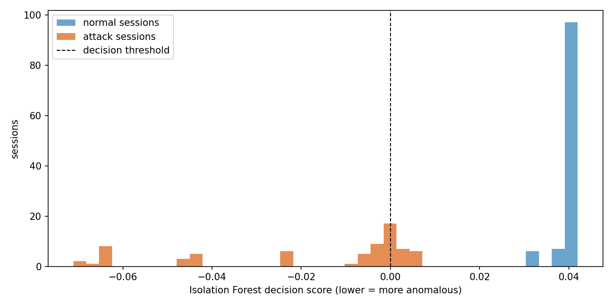

# Threat Intelligence System

Unsupervised detection of suspicious network sessions with an Isolation Forest, an alerting layer that turns detections into severity-ranked alerts with evidence, a Flask API and dashboard, and CrewAI definitions for the Detector, Analyzer and Reporter roles.

## Results

The model is trained on a 1,500-session synthetic benchmark and evaluated twice: on the benchmark's held-out 30%, and on the separately built project dataset (`sources/network_logs.csv`), which is never used for training.

| | Benchmark, held-out sessions | Project dataset, never seen |
|---|---|---|
| Sessions (suspicious) | 450 (65) | 180 (70) |
| ROC-AUC | 0.978 | 1.000 |
| Precision | 0.90 | 1.00 |
| Recall | 0.80 | 0.71 |
| False alarms on normal sessions | 6 of 385 | 0 of 110 |

Detection rate by attack type:

| Attack | Benchmark | Project dataset |
|---|---|---|
| Brute-force logins | 91% | 100% |
| Port scan / reconnaissance | 100% | 100% |
| Data exfiltration | 100% | 50% |
| Successful login from an unusual country | 15% | not in dataset |



### What the numbers say

- **The scores rank the project dataset perfectly; the threshold is what misses.** Every normal session scores between +0.03 and +0.04, and all 20 missed attacks sit just above the threshold at 0 to +0.007. They are exfiltrations: in the project data they move about 17 KB per session (median), against about 2.3 MB in the benchmark the model learned from. The alert threshold is an operating decision, not a property of the model.
- **Quiet account takeover is close to invisible to a behavioural detector.** A successful login from an unusual country followed by ordinary browsing looks like a normal session, so only 15% are flagged. Catching those needs identity signals (impossible travel, new device), not anomaly scores.
- **Noisy attacks are easy.** Bursts of failed logins and scans across many hosts are flagged almost every time on both datasets.

Full numbers, including the severity assigned to every flagged session: [`reports/synthetic/metrics.json`](reports/synthetic/metrics.json) and [`reports/project/metrics.json`](reports/project/metrics.json).

## How it works

1. **Data.** `data_prep/generate_logs.py` builds the benchmark from seven scenarios: normal browsing, logins and uploads, plus brute force, port scans, night-time exfiltration and logins from unusual countries. Normal traffic deliberately overlaps with attacks (travellers, mistyped passwords, large legitimate uploads) so no single rule separates them.
2. **Features.** `data_prep/feature_engineering.py` turns raw events into one row per session: failed and successful logins, scans, transfers, bytes moved, distinct destinations, request rate, hour of day, how often the source IP appears, and whether the country is unusual.
3. **Model.** `data_prep/model.py` fits a 200-tree Isolation Forest on the training split only. Labels are never features; they only set the expected anomaly share (the contamination) that places the alert threshold.
4. **Alerts.** `threat_intel/pipeline.py` scores each session and turns anomalies into alerts graded critical, high or medium from the evidence (repeated failed logins, unusual country, large transfers, request floods), each with a plain-language description and a recommended action.
5. **Agents.** `threat_crew/` defines the Detector, Analyzer and Reporter roles, tasks and tools with CrewAI. By default each stage runs as deterministic Python through the same pipeline, so the project works without LLM credentials.
6. **API and dashboard.** `api/app.py` serves `/detect`, `/api/alerts`, `/api/summary` and an analyst dashboard.

## Run it

```bash
pip install -r requirements-dev.txt          # add requirements-agents.txt for CrewAI

# rebuild everything from scratch
python -m data_prep.generate_logs            # -> sources/synthetic_logs.csv
python -m data_prep.feature_engineering      # -> data_prep/outputs/features_dataset.csv
python -m data_prep.model                    # -> data_prep/outputs/models/isolation_forest.joblib
python -m data_prep.evaluate                 # held-out benchmark -> reports/synthetic/
python -m data_prep.evaluate --logs sources/network_logs.csv --split all --out reports/project

pytest                                       # 15 tests
python api/app.py                            # dashboard at http://localhost:5002/dashboard
python threat_crew/src/threat_crew/main.py   # run the workflow on sample_logs.txt
```

`POST /detect` takes `{"logs": ["<12 comma-separated fields>", ...]}` with the fields `timestamp,user_id,session_id,src_ip,dst_ip,country,event_type,action,status,bytes,stage,label`. `stage` and `label` may be `unknown`; they are only used for evaluation.

## Security

Log content is attacker-controlled, so the service treats it that way:

- The dashboard escapes every log-supplied field before rendering it. A session id like `<script>…</script>` is shown as text, not executed (covered by a test).
- There is no endpoint that fetches URLs on the server's behalf. An earlier `/detect_url` did, which allowed requests to internal addresses (SSRF); it was removed.
- Requests are capped at 2 MB and 5,000 log lines.

## Repository layout

```
sources/            synthetic benchmark + project dataset (labelled)
data_prep/          generator, feature engineering, training, evaluation, PostgreSQL export
threat_intel/       scoring, severity rules, alert store
api/                Flask API and dashboard
threat_crew/        CrewAI roles, tasks and tools
reports/            evaluation metrics and plots for both datasets
tests/              pipeline, features, API, security and model-quality tests
```

Set `DATABASE_URL` (see `.env.example`) to also write session features to PostgreSQL.

## Limitations

- Both datasets are simulated. Real traffic is noisier and its attack mix changes over time, so the threshold would need re-tuning on real data.
- `ip_request_freq` is counted within each submitted batch, so a very small batch understates it compared with training.
- "Unusual country" is a fixed allowlist (JO, US).
- Alerts are kept in memory and reset when the API restarts.
